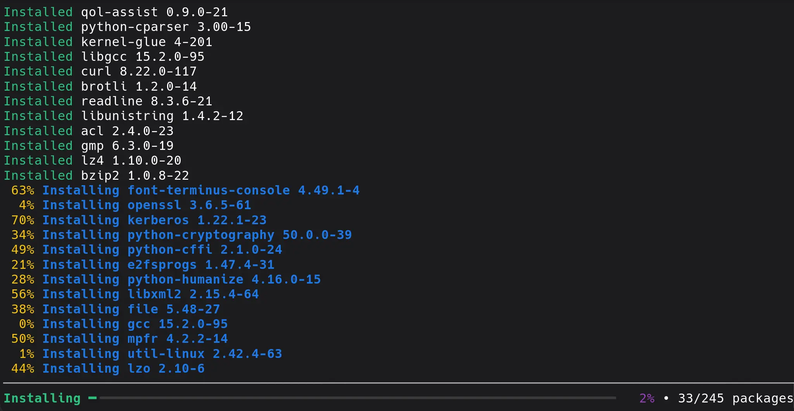

---
authors:
  - image: https://avatars.githubusercontent.com/u/5338090?v=4
    link: https://github.com/joebonrichie
    name: Joey Riches
tags:
- news
- eopkg
- package manager
date: '2026-10-11'
title: 'eopkg v6.0.0 Released'
url: '/:year/:month/eopkg-6'
summary: "We're excited to announce eopkg v6.0.0, a new major release focused on making eopkg fast. Packages are now downloaded concurrently, operations (install/upgrade/remove) are now parallelized, the user interface has been revamped, and more!"
---


We're excited to announce eopkg v6.0.0, a new major release focused on making eopkg fast. Packages are now downloaded concurrently, operations (install/upgrade/remove) are now parallelized, the user interface has been revamped, and more!

## Release Highlights since eopkg v4.5.0
     
- Any checks are now done before any files on disk are changed; previously some checks were run per-package event which could cause an operation to fail mid-way through.
- Packages are now downloaded concurrently instead of sequentially.
- All operations (install/upgrade/remove) are now parallelized.
- The CLI frontend has been revamped, making use of the `rich` library to display per-worker progress events.
- Pickle cache databases are now only updated once an operation is finished, rather than for each package event.
- eopkg now handles stale or malformed package directories more gracefully, e.g. it is no longer required to run `eopkg delete-cache` to workaround malformed package entries making their way into the database cache.
- eopkg now supports installing from a provider from the CLI, e.g. `eopkg it 'pkgconfig(zlib)'`



## Benchmarks

**1. Concurrent downloads**

| Connection | Workers | Package set                      | v4.5.0  | v6.0.0  | Speedup |
| ---------- | ------- | -------------------------------- | --------| --------| ------- |
| 150Mbps    | 8       | `system.base`                    | 0:23.37 | 0:11.55 | 2.02x   |
| 150Mbps    | 8       | `system.base` + `system.devel`   | 0:38.06 | 0:21.49 | 1.77x   |
| 150Mbps    | 8       | GNOME ISO package list (780 pkgs)| 4:17.14 | 3:06.37 | 1.37x   |

**2. Parallelized installation**

| Package set                      | Workers | v5.0.0  | v6.0.0   | Speedup |
| -------------------------------- | ------- | ------- | -------- | ------- |
| `system.base`                    | 8       | 0:08.70 | 0:04.71  | 1.84x   |
| `system.base` + `system.devel`   | 8       | 0:29.86 | 0:09.06  | 3.29x   |
| GNOME ISO package list (780 pkgs)| 8       | 1:54.76 | 0:50.78  | 2.25x   |

**3. Combined (download & installation)**

| Package set                      | v4.5.0  | v6.0.0   | Speedup |
| -------------------------------- | ------- | -------- | ------- |
| `system.base`                    | 0:34.51 | 0:14.50  | 2.38x   |
| `system.base` + `system.devel`   | 1:05.54 | 0:28.03  | 2.33x   |
| GNOME ISO package list (780 pkgs)| 5:42.33 | 3:36.67  | 1.57x   |

## Brief History
     
`eopkg` is a fork of the `pisi` package manager used in Pardus Linux and roughly stands for "Packages Installed Successfully as Intended". It was forked by Ikey Doherty in 2013 for use in what became Solus (originally EvolveOS), and, renamed over disagreements of the use of PiSi naming in 2016, hence the name eopkg.

`pisi` was written in the Python 2 era, and bears the mark of a lot software design paradigms of the day. It makes heavy use of XML as well some limited use of object orientated programming. It makes use of Python's pickle cache to build a "lazy database" of package and repository metadata, which hides most of the cost of heavy XML processing. To process XML it uses the `iksemel` library, which provides python bindings. `iksemel` is significantly faster than XML options provided by the Python standard library as well as popular libraries such as LXML. When PiSi was developed, 64bit and multi-core processors were just becoming mainstream; which meant that everything in PiSi was sequentially designed. With clever use of Python's pickle cache and a fast XML processing library, it was relatively fast at the time.

After a long effort, with much hair-pulling involved, `eopkg` was ported to Python 3 (finally!) in mid-2024 with the help of many contributors, with a compiled version built with [Nuitka](https://nuitka.net/) used in production. Since the port to Python 3, it gradually received modernization and quality of life improvements. Parallelism in `eopkg` was always a desired feature, however, being sequentially designed, the API made de-tangling operations hard, Objects had to make their way through several layers of abstraction to become fully initialized to actually perform an operation. One example of this is that packages used to be implicitly downloaded once the package object was initialized.

The design of `eopkg` was starting to show it's age. You may even call it "embarrassingly sequential". Multi-core systems had become the norm, internet connection speeds had increased, meanwhile, Python has remained slow compared to compiled languages. Once the Python 3 port was stabilized, it allowed us to implement the following improvements.

In eopkg v4.5.0, it switched from using `lzma` to `lzma_mt`; this allowed packages to be compressed and decompressed with multiple threads.
In eopkg v5.0.0, package downloads were now done concurrently.
In eopkg v6.0.0, operations were now parallelized.

## Future Changes
     
We still want to improve on eopkg. Some ideas being considering include:

- Improve internal API design that assumes sequential executions.
- Add a remote file index file for searching for files in packages not installed.
- Add support for updating appstream catalogs & icons when updating the index to keep software center metainfo continually up-to-date.
- Investigate GIL-free Python as it stabilizes, it should allow us to simplify the parallelism design.
- Improve atomic-ness under the hood.
- Improve lock design to allow for multiple instances to run concurrently.
- Add support for more 'providers', e.g. `python(foo)`, `cmake(bar)`, etc.

## Additional optimizations

### iksemel

As previously mentioned, `iksemel` is the XML parsing library that `eopkg` uses. It is written in a very classical way, using a big state machine `while`-loop that checks every byte processed against a list of potential delimiters. As part of optimizing `eopkg`, we also spent some time optimizing this library.

Modern processors attempt to speculatively predict conditional branches taken within a code path, and any branch mispredictions end being extremely costly. Now, you can imagine for a big XML state machine loop which checks each byte one by one, branch mispredictions can greatly reduce performance.

Imagine parsing this piece of XML:
```xml
<?xml version="1.0" encoding="UTF-8" ?>
<text lang='en'>The fox jumped over the lazy dog</text>
```

The majority of the time is spent on the embedded text. The parser only needs to pay special attention to the characters that define the tag boundaries, attribute value, and end tag.

We settled on using character classification LUTs (look-up tables) to improve performance. You can imagine them as a tiny reference table with entries for each possible byte value that we care about. With LUTs, we can fast scan over chunks of text at a time until we find a special character we have to care about, then handle that specifically, instead of making the parser perform a full-set of decision making for every byte. This allows the processor to stay in a 'happy path' for a longer period of time, which ends up being significantly faster.

For the eopkg index file, which is currently ~70MiB, this provided a 2.33x speedup.

By splitting out 'fast-scan' sections, this also allowed us to target additional optimizations such as [SIMD](https://en.wikipedia.org/wiki/Single_instruction,_multiple_data). Single instruction, multiple data allows a processor to apply the same operation to several pieces of data simultaneously. For example, all Intel and AMD processors contain support for [SSE2](https://en.wikipedia.org/wiki/SSE2) which provides 128bit registers. For our text section, each character is one byte meaning we can fit 16 characters in a register and process them simultaneously with just one instruction.

For example, in processing 'The fox jumped over the lazy dog', we can process `The fox jumped o`, `ver the lazy dog` with just two instructions using 16 characters each. When a special character is found, we can return back to the main parser loop at the point in the chunk we found the special character.

The SSE2 optimizations provided an additional 1.10x speedup when parsing the eopkg index file.

The total speedup for parsing the eopkg index XML file from baseline was 2.57x, which is a fantastic result. In terms of `eopkg`, these optimizations particularly speedup the `list-upgrades` subcommand, as well as calculating dependencies when upgrading or installing packages.

## Closing thoughts

eopkg v6.0.0 is a significant release, making general package operations way faster. For everyday users, updates and installs will take less valuable time.

It also ends up being a particularly huge boon for packaging. When packaging, all a build recipe's dependencies are installed in a throwaway container for each build. This is a welcome update for our packagers, significantly reducing iteration time for everyday updates, rebuilds, new packages, or, when fighting with a particularly challenging package.

Lastly, we want to give a shout-out to all of our supporters on [OpenCollective](https://opencollective.com/getsolus). We are grateful to all of our backers who fund our work, and help us bring this Linux distribution to everyone. Solus could not operate without your help. Your donations pay for our server infrastructure and services like email. They also help reimburse contributors for long-term and complex package and development work. You can become a backer today for as little as $1 a month. Thank you.
